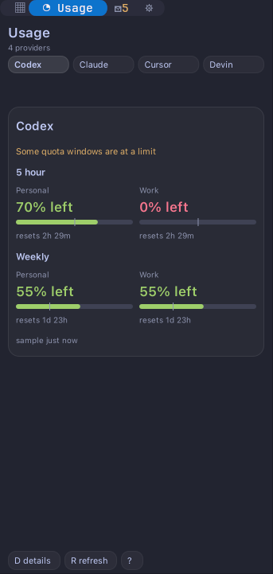
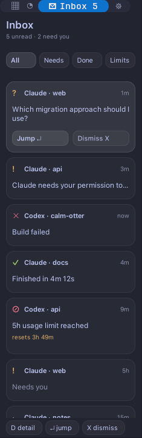
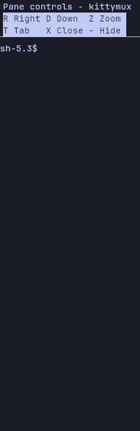

# Rex-inspired UI qualification — 2026-11-15

Status: implemented on `rex-ux-20261115`; independent review and hosted CI pending. Main and live terminals have not been changed.

The existing opt-in pixel panel now draws Usage and Inbox as well as Agents. Usage keeps each T3/rice account separate, labels quota remaining and reset/pace, and reports unknown sample ages. Inbox expands without acknowledging or focusing, preserves selection by ID, and retains unread attention ahead of read history. The optional Kitty 0.50 pane dock uses an explicit parent, guarded close and existing native actions.

## Verified locally

- All 1,983 unit tests passed, including regression tests for canonical notification IDs, unread retention, selection changes, full error bodies, expansion, footer reachability, unknown/future sample timestamps and native dock initialization.
- `smoke_panelpx` passed in dark/light at 26/38 columns, with real pointer expansion/dismissal, Undo, native dock idempotence and pointer splitting. Its disabled-graphics control failed at the first graphics assertion as intended. Other-Kitty window counts were unchanged. Before/after PNGs were read. Cell `shot_panel` checks covered both themes and widths, including narrow help and footer fixes.
- Required private rigs passed: inbox, prompts, spawn, state, sidebar, peek, palette, resize, reload, keys, panes, native divider, clicks, drag and panel focus. `stress_panel` passed 150 cycles without unbounded memory/descriptor/thread growth; idle CPU was 1% under software Xvfb.
- Python compilation, shell syntax, ShellCheck and diff whitespace checks passed. Docs/site checks passed: `test_docs`, agent guide/secret checks, `bun run check`, `axe`, `budget` and `cls` (zero measured layout shift).
- Warm pure rendering at 342×720 over 100 samples: Usage median 0.59 ms / p95 0.79 ms; 60-event Inbox median 2.30 ms / p95 3.06 ms. This measures local CPU rendering, not terminal transport or live GPU performance.

## Screenshots

All examples use synthetic accounts and messages.

## Boundaries

Native docks were exercised on Kitty 0.50. Older running processes are rejected by the controller's version gate; their actual runtime is left unchanged. Pixel views remain opt-in and preserve cell fallback. No daemon, new provider connection or global chord was added.

Live providers, Hyprland/layer-shell placement and real GPU behavior were not qualified by these private-Xvfb runs. No live focus change, restart or reload was performed. Unread storage remains bounded: compaction keeps at most 200 events, prioritizing attention while reserving the current event's canonical ID; at capacity an older unread event can be evicted.

## PR review fixes

All eleven CodeRabbit inline findings were confirmed and addressed. Regression tests cover absent window-ID ownership, shared CLI errors, delayed report IDs through compaction (including discarded intervening history), OS-window movement scope, applicable-axis Zoom, local source cache age/live status and selection aging out. Compacted adds carry an internal folded-occurrence marker; public snapshots omit it. CI now installs the renderer libraries and treats missing graphics dependencies as a failure. The rig uses observable-state and stable-frame waits with deadlines; disabled-graphics and missing-library controls both fail as intended.

Hosted CI was green on the original feature commit, but its graphics step could skip. Results for the stricter revised commit remain pending.

## Hosted-runtime follow-up

The strict graphics check exposed that upstream self-contained Kitty binaries cannot import the runner's system Cairo/GI extensions. The smoke matrix now builds pinned Kitty release sources against the runner's system Python and asserts renderer imports before tests. A temporary source build of 0.49.2 passed the actual pixel/scroll rig locally; the original bundled 0.49.2 reproduced the missing-GI fallback and passed the existing sidebar rig. The intermittent hosted absorb failure has not reproduced locally; its exact-pane-count assertion remains, with a longer completion deadline and private window diagnostics on failure.

The scroll test now uses enough cards to overflow the viewport and captures its baseline after Undo. A disabled-PageDown control passed before the fix and now fails specifically at the scroll assertion, comparing a fixed top-card text region that excludes clocks and footer timers. Updated hosted results remain pending.
