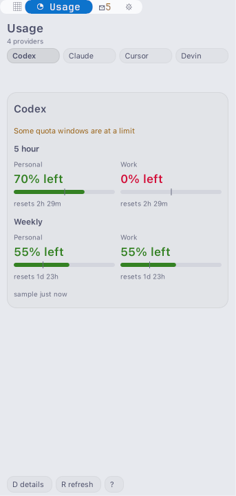

# Rex-inspired UI qualification — 2026-11-15

Status: implementation and review complete. All ten hosted checks passed on functional-code commit `317c675`; all twelve CodeRabbit review threads were resolved. This dated report records validation before integration. [PR #45](https://github.com/KitsuneKode/kittymux/pull/45) tracks the current checks, merge and live-integration status.

The existing opt-in pixel panel draws Usage and Inbox as well as Agents. Usage keeps each T3/rice account separate, labels remaining quota and reset/pace, and reports unknown sample ages. Inbox expands without acknowledging or focusing, preserves selection by ID, and retains unread attention ahead of read history. The optional Kitty 0.50 pane dock uses an explicit parent, guarded close and existing native actions.

## Verified

- All 1,983 unit tests passed, including canonical notification IDs, delayed-event replay through compaction, unread retention, full error bodies, selection aging out, unknown/future sample timestamps, owning-Kitty scope, OS-window movement and two-pane Zoom restoration.
- Hosted `smoke (0.49.1)`, `smoke (0.49.2)` and `smoke (0.50.0)` each logged a real `PASS` for pixel Usage/Inbox. The step requires graphics and cannot silently skip missing dependencies.
- Private real-pointer graphics runs passed in dark/light at 26/38 columns. Expansion, dismissal, visible restoration, Undo and scrolling were exercised. The dock was idempotent, split by pointer, restored Zoom on both two-pane orientations, and moved to a new tab in its original OS window after another OS window received focus. Other-Kitty window counts were unchanged. Before/after PNGs were read. Cell `shot_panel` checks passed all four theme/width combinations.
- Controls rejected disabled graphics, missing renderer dependencies, disabled PageDown and a stale dismissed frame despite restored stored counts. The scroll baseline requires the card to disappear after Dismiss and visibly reappear after Undo. Text masks exclude selection colors, clocks and footer timers.
- Private inbox, prompts, spawn, state, sidebar, peek, palette, resize, reload, keys, panes, native divider, clicks, drag and panel-focus checks passed. Panel stress passed 150 cycles without unbounded resource growth; idle CPU was 0.9% under software Xvfb.
- Compilation, shell syntax, ShellCheck, docs, secret checks and whitespace checks passed. Site check/build/crawl, axe, budget and CLS passed, with zero measured layout shift. Hosted unit, security, site and compatibility checks passed on `317c675`.

Warm pure rendering at 342×720 over 100 samples measured Usage median 0.59 ms / p95 0.79 ms and a 60-event Inbox median 2.30 ms / p95 3.06 ms. This measures local CPU rendering, not terminal transport or live GPU performance.

## Screenshots

Representative examples use synthetic accounts and messages.

## Runtime and qualification boundaries

The hosted matrix builds exact Kitty release sources against system Python so Cairo/GI extensions match that interpreter. It supplies pinned Symbols Nerd Font and Slang build inputs, then checks renderer imports inside Kitty before running the strict graphics test. Upstream self-contained binaries use their own Python and may legitimately fall back to cells despite system packages being present; this was reproduced with the official 0.49.2 binary.

Native docks were exercised on Kitty 0.50. Older running processes are rejected by the controller's version gate. Pixel views remain opt-in with cell fallback. No daemon, new provider connection or global chord was added.

Live providers, Hyprland/layer-shell placement and real GPU behavior were not qualified by private-Xvfb runs. No live restart was performed during qualification. Unread storage remains bounded: compaction keeps at most 200 events, prioritizing attention while reserving the current event's canonical ID; at capacity an older unread event can be evicted. The internal folded-occurrence marker prevents re-merging distinct retained events and is omitted from public snapshots.

The earlier intermittent hosted absorb count mismatch did not reproduce locally with bundled or source-built Kitty 0.49.2. Its exact pane-count assertion remains, with a completion deadline, private window diagnostics, isolated home/usage/socket directories and an other-Kitty tripwire. All three final hosted compatibility jobs passed.
