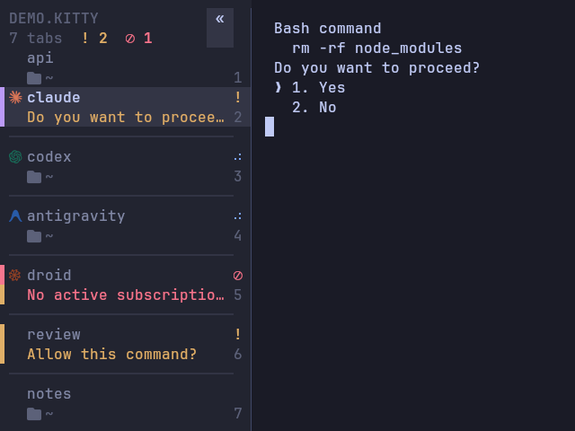

Every tab with an agent in it shows exactly one state. The tab bar, the deck, the docked panel and the `ctrl+alt+y` jump all show the same one, because they read one shared answer.



## The states

| Glyph               | State        | Meaning                                                                                              |
| ------------------- | ------------ | ---------------------------------------------------------------------------------------------------- |
| `◐◓◑◒` (steps)       | **working**  | The agent is busy. The circle fills a quarter turn every 3 seconds, on any window; it never spins.   |
| `!`                 | **waiting**  | It is asking you something: a permission prompt or a question. The question is shown as the reason.  |
| `⊘`                 | **limited**  | A usage limit or quota is exhausted. Nothing will happen until you act.                              |
| `✕`                 | **error**    | The agent reported an error. The message stays. It is not a finished run, and focusing the pane does not clear it. |
| `✓`                 | **done**     | It finished while you were looking elsewhere. It clears the moment you focus it.                     |
| nothing             | idle         | An agent is running and not doing anything.                                                          |
| `•`                 | unread       | Output arrived in a tab that has no agent.                                                           |

When more than one applies, the order is limited, then waiting, then error, then working, then done, then idle. A tab shows its panes rolled up: the most important state of all of them, not just the focused pane's. Jumping to a tab that needs you lands on the pane that is asking.

## How it knows

Twice a second, and every two seconds when no agent is running, kittymux reads the bottom of each agent pane's screen. It looks for the markers real agents print, such as `esc to interrupt`, `Do you want to proceed?` and `usage limit reached`, and combines them with hook status when you have hooks.

**A state needs positive evidence. Silence is never "waiting".** A quiet title is not read as waiting. An agent you interrupted does not spin forever. A "waiting for your input" idle notice is not a request.

Claude, Codex, Devin, Gemini, Cursor, OpenCode, Amp, Antigravity and Factory `droid` work with no setup. Other agents with a logo, and aider and crush, use hooks or title activity. See [Platforms and compatibility](/docs/users/platforms) for which markers have been checked against live sessions.

### Status the agent reports itself (OSC 7501)

Claude Code, Pi and Crush report what they are doing with the Program Status Protocol (OSC 7501): working, blocked on a permission or a question, done, error. kitty does not read it yet, so kittymux can run agents it starts behind a small relay, `mux-pty`, that passes every byte through unchanged and hands the report to the scanner. A reported status is the strongest evidence there is: "blocked" shows as waiting with the agent's own question, "done" counts as the agent's word, and "error" is its own state (`✕`, the alert colour) with the message kept. A quiet screen does not turn that error into a finished run, and a screen that still looks busy does not hide it. A permission prompt or a usage limit still comes first. The screen markers above remain the fallback for agents that don't report.

It is off by default. Turn it on with `kittymux settings` (the **Agent status relay** switch, in Opt-in) or the panel's Settings view; agents you spawn or fan out after that run behind the relay. Agents you start by hand can use it too: `mux-pty -- claude`.

### When is something "done"?

A false "finished" is worse than none, so the rules are strict.

- **The agent's own word wins.** When a hook announced the turn, only the agent's `Stop` hook ends it. A quiet screen between tool calls, a repaint or an `esc` interrupt is not a completion. Agents without hooks are judged by the screen alone.
- **An answered permission request is not "done".** It is why the agent paused.
- **A limit ends when its reset time does.** When the message names a time ("try again at 9:21 PM", "resets in 2h 30m"), the tab says when it lifts (`↻12m`, "resets in 12m" in the panel) and stops being limited at that time, even while the old message is still on screen. A fresh message with a new time is a new limit. With no time in the message, the tab stays limited until the screen changes.
- **One limit, one notification.** An agent that you retry prints the same limit message again, and the tab flips between working and limited. That is one episode: it is announced once, not once per retry.
- **A busy line above an idle prompt is old output.** Devin shows "Ask Devin to build features" only when it is idle. A line such as `Working (1s • esc to interrupt)` printed above it, for example a pasted log, does not make the tab work.
- **Prose is not a prompt.** Text like `(y/n)` or "usage limit reached" inside the agent's own reply, above a live spinner, is ignored. A real dialog, which has `esc to cancel` chrome, still wins.
- **A completion has to settle and be known.** It counts only after the pane stays finished for five seconds, and it notifies only when kittymux saw it work for at least 15 seconds.

## Hooks

Hooks add what the screen cannot say: the exact message an agent is waiting on, and instant transitions. They are optional and used alongside the screen.

```sh
kittymux hooks --install    # merges the Claude Code hooks into ~/.claude/settings.json, after a backup
kittymux hooks --remove     # takes exactly those entries back out; every other hook is untouched
kittymux hooks              # only prints the snippet
```

The Claude Code events are `UserPromptSubmit` and `PostToolUse` for working, `Notification` for waiting, `Stop` for done and `SessionEnd` for idle. `kittymux doctor` tells you when one is missing. To add them by hand:

```json
{
  "hooks": {
    "UserPromptSubmit": [{ "hooks": [{ "type": "command", "command": "~/kittymux/bin/mux-status working" }] }],
    "PostToolUse":      [{ "hooks": [{ "type": "command", "command": "~/kittymux/bin/mux-status working" }] }],
    "Notification":     [{ "hooks": [{ "type": "command", "command": "~/kittymux/bin/mux-status waiting" }] }],
    "Stop":             [{ "hooks": [{ "type": "command", "command": "~/kittymux/bin/mux-status done" }] }],
    "SessionEnd":       [{ "hooks": [{ "type": "command", "command": "~/kittymux/bin/mux-status idle" }] }]
  }
}
```

`mux-status` takes `working`, `waiting`, `done` or `idle`. For another agent, call it from whatever hook or notify command that agent offers. It writes a window variable that kittymux reads, works over ssh without a socket, and never blocks or fails the agent. The waiting message comes from `--msg`, from the hook's JSON on standard input, or from a JSON last argument.

Inside tmux the escape needs passthrough. kittymux then falls back to kitty's remote control, which needs `listen_on`.

## Ask why

When a state is not what you expected, ask:

```sh
kittymux explain
```

```
kitty 4062
  win 77    claude       working  Kitty lightweight tm         the screen shows a busy marker
  win 192   codex        limited  Audit codebase securit       the screen shows a usage-limit message

  recent decisions (oldest first):
  23:58:31  win 77    claude     idle → working       the screen shows a busy marker
  00:03:02  win 77    claude     working → done       its Stop hook fired
  00:03:07  win 77    claude     notify done          sent (worked 271 s)
  00:09:40  win 18    claude     notify done          suppressed: worked only 4 s (< 15 s)
```

Every state change and every notification decision is recorded: sent, or the reason it was held back, such as you were looking at it, it is switched off, a rate limit, too short or an unknown duration. `--window ID` filters, `--last N` sets how many, `--all` covers every running kitty and `--json` is for scripts.

The log is a bounded in-memory list of 300 events plus a private file per kitty that rotates at 192 KB. It holds reason codes and window ids, never screen text.

## Splits

A split tab shows a to-scale picture of its panes under its title, each pane tinted by its state: amber waiting, blue working, red limited, with the focused pane brighter. Each agent pane is also listed on its own, as indented child lines in the deck and panel (you can hover to preview that pane and click to focus it) and as small logo-and-state chips in the bar.
