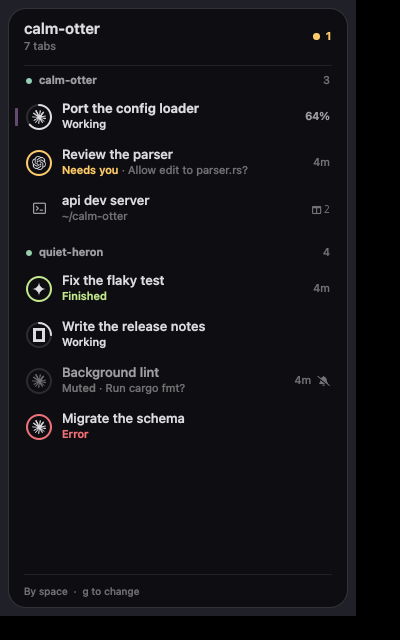
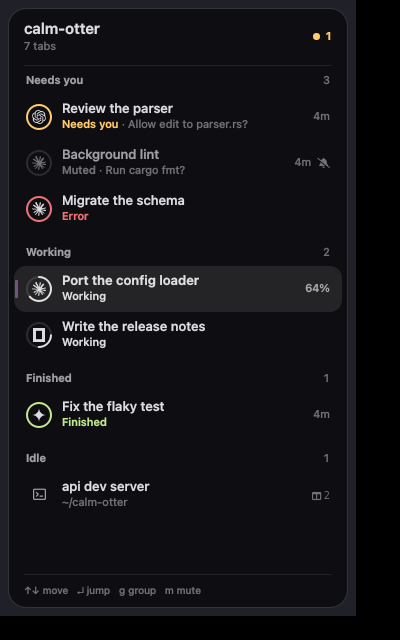
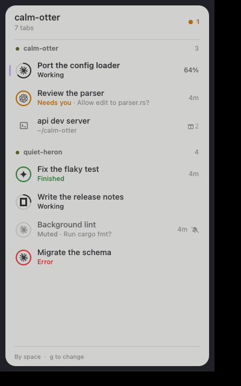

kitty draws its tab bar and the panel in terminal cells. The kittymux client draws them as a real interface beside kitty instead. It is a small [Quickshell](https://quickshell.org) program docked to the edge of your screen. kitty stays your terminal and does not change; the client only reads what kittymux publishes and acts when you click.



## Start it

```sh
kittymux client            # toggles it; also: start, stop, status
```

It needs Quickshell and a Wayland compositor with layer-shell (Hyprland, Sway, niri, KDE). It docks on the left; set `KITTYMUX_CLIENT_EDGE=right` or `KITTYMUX_CLIENT_WIDTH=340` before starting it to change that. Bind `kittymux client` in your window manager to reach it from any app.

## What it shows

- **The header** names where you are first: the project of the tab you are in, its branch and how many tabs are open. An orange count on the right says how many tabs need you, and is gone when none do.
- **Each tab** is two lines: its title (heavier for the tab you are in, with a soft accent mark on its edge), then its state in words and what it is about: the question it asks, where it runs, how long it has waited.
- **The ring** around an agent's mark carries the state at a glance. Working is a quarter arc that steps a quarter turn every 3 seconds, or fills to the percent when the program reports one. Needs you is orange and pulses once when it starts asking. Finished is green and error is red. Idle tabs have no ring.
- **A muted agent** is drawn faint, says Muted and shows a bell-slash. It never counts in the orange number.

Colour is only for state: the accent marks where you are, orange means it needs you, green finished, red error. All of them come from your kitty theme.



## Use it

| To | Mouse | Keyboard (click the client first) |
| --- | --- | --- |
| Go to a tab | Click it | `up` `down` or `j` `k`, then `enter` |
| Group by state, or back by space | | `g` |
| Mute or unmute an agent | Right-click, then Mute | `m` |
| Close the menu, clear the selection | Click elsewhere | `esc` |

The client takes the keyboard only when you click it, and gives it back when you click elsewhere. `g` is the same choice as `g` in the [docked panel](/docs/users/peek-deck-and-panel): change it in one and the other follows.

## Blur behind it

The client's background is translucent so your compositor can blur what is behind it. On Hyprland, add a layer rule for its namespace to your own config:

```ini
layerrule = blur, kittymux-client
layerrule = ignorezero, kittymux-client
```

## Light themes and motion

On a light kitty theme the client turns light too.



Motion follows kittymux's rules. Switch `motion` off (`kittymux features`) and the working ring holds still; set `KITTYMUX_REDUCE_MOTION=1` and the glides and pulses go as well, leaving only fades.

## What it costs

At rest it uses no CPU. With an agent working it uses about half a percent, measured under Xvfb with Qt's software renderer, which repaints only what changed. That is the default. Set `KITTYMUX_CLIENT_GPU=1` to draw with OpenGL instead. Memory is that of a small Qt program.

## Limits

- It is a separate surface docked to the screen's edge, not part of a kitty window. A floating kitty window does not carry it along.
- It needs Wayland with layer-shell. On X11, keep using the tab bar and the panel.
- Pane title bars inside kitty are still drawn by kitty.
