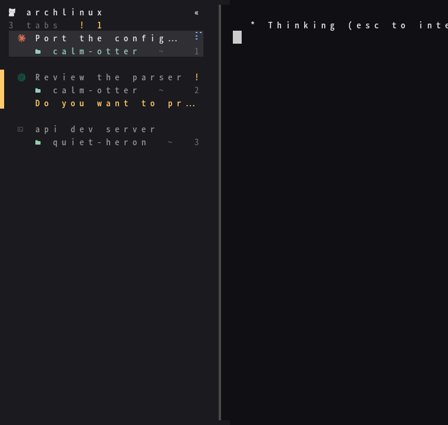
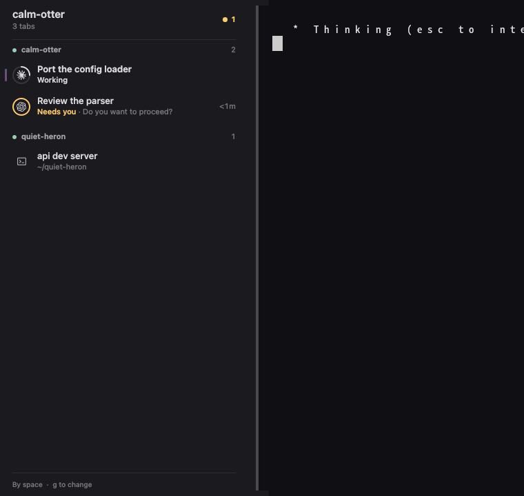
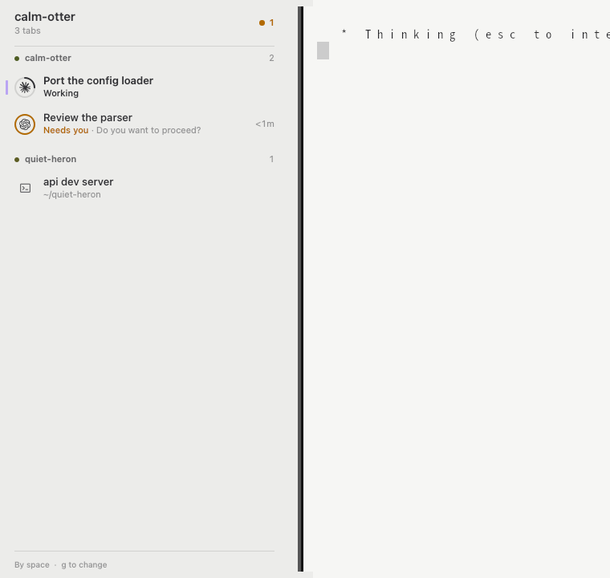

kitty draws its tab bar in terminal cells. The kittymux client draws that sidebar as a real interface instead, with proportional type, rings and smooth motion. It is a small [Quickshell](https://quickshell.org) program. kitty stays your terminal and does not change; the client only reads what kittymux publishes and acts when you click.

By default it docks to the edge of the screen. On Hyprland it can also sit **in each kitty window's own vertical bar** (attach mode, experimental): kitty keeps the bar's place, background, blur and divider and stops drawing tabs there, and the client draws the content on top.

<Callout type="warn" title="Attach mode is experimental">
  A separate surface has to work out where kitty is and at what scale. On a desktop with fractional scaling it has landed beside the bar instead of on it, with its text smaller than kitty's. Turn it on with `KITTYMUX_CLIENT_MODE=attach` only to try it; kitty's own bar is the way to use kittymux inside the window.
</Callout>





## Start it

```sh
kittymux client            # toggles it; also: start, stop, status
```

It needs Quickshell and a Wayland compositor with layer-shell. Your kitty needs its bar on the left or right (`kittymux layout edge left`) for the client to sit in it.

| Mode | Where | When |
| --- | --- | --- |
| dock | a column on the screen's edge, beside your windows | the default |
| attach | in each kitty window's own vertical bar | Hyprland, experimental: `KITTYMUX_CLIENT_MODE=attach` |

In dock mode, `KITTYMUX_CLIENT_EDGE=right` and `KITTYMUX_CLIENT_WIDTH=340` change where and how wide. Bind `kittymux client` in your window manager to toggle it from any app.

### How attach follows the window

kitty knows where its bar is; Hyprland knows where the window is. The client asks Hyprland again whenever it says something changed and whenever kitty reports a resize. While Hyprland moves windows (a workspace switch, a new window, fullscreen) the client fades out and comes back where the window lands, so it never trails behind the animation. It stays hidden while the bar is not what you see: another workspace, a fullscreen window, or a floating window across the bar. When the client stops, kitty draws its own tabs again within a second or two.


## What it shows

- **The header** names where you are first: the project of the tab you are in, its branch and how many tabs are open. An orange count on the right says how many tabs need you, and is gone when none do.
- **Each tab** is two lines: its title (heavier for the tab you are in), then its state in words and what it is about: the question it asks, where it runs, how long it has waited. One soft accent mark on the edge says where you are, and glides to the tab you switch to.
- **The ring** around an agent's mark carries the state at a glance. Working is a quarter arc that steps a quarter turn every 3 seconds, or fills to the percent when the program reports one. Needs you is orange and pulses once when it starts asking. Finished is green and error is red. Idle tabs have no ring.
- **A muted agent** is drawn faint, says Muted and shows a bell-slash. It never counts in the orange number.

Colour is only for state: the accent marks where you are, orange means it needs you, green finished, red error. All of them come from your kitty theme.


## Use it

| To | Mouse | Keyboard (click the client first) |
| --- | --- | --- |
| Go to a tab | Click it | `up` `down` or `j` `k`, then `enter` |
| Group by state, or back by space | | `g` |
| Mute or unmute an agent | Right-click, then Mute | `m` |
| Close the menu, clear the selection | Click elsewhere | `esc` |

The client takes the keyboard only when you click it, and gives it back when you click elsewhere. `g` is the same choice as `g` in the [docked panel](/docs/users/peek-deck-and-panel): change it in one and the other follows.

## The glass

In attach mode the client has no background of its own: the glass is your kitty window's. Give kitty a translucent background and let the compositor blur it, and the sidebar is frosted along with the panes.

```ini
# kitty.conf
background_opacity 0.85
```

Tell Hyprland not to animate the client's layer: the client fades itself in and out as windows move, and a second animation on top looks like lag. In `hyprland.conf`:

```ini
layerrule = noanim, kittymux-client
```

The docked mode draws its own glass, so there give its layer the blur as well:

```ini
layerrule = blur, kittymux-client
layerrule = ignorezero, kittymux-client
```

## Light themes and motion

On a light kitty theme the client turns light too.



Motion follows kittymux's rules. Switch `motion` off (`kittymux features`) and the working ring holds still; set `KITTYMUX_REDUCE_MOTION=1` and the glides and pulses go as well, leaving only fades.

## What it costs

At rest it uses no CPU. With an agent working it uses about half a percent, measured under Xvfb with Qt's software renderer, which repaints only what changed. That is the default. Set `KITTYMUX_CLIENT_GPU=1` to draw with OpenGL instead. Memory is that of a small Qt program.

## Limits

- Attach mode needs Hyprland, and a bar on the left or right. A window you drag by hand is followed when you let go, not during the drag.
- The client is a separate surface laid over the bar, so a screenshot tool that captures one window sees kitty's blank bar.
- It needs Wayland with layer-shell. On X11, keep using the tab bar and the panel.
- Pane title bars inside kitty are still drawn by kitty.
